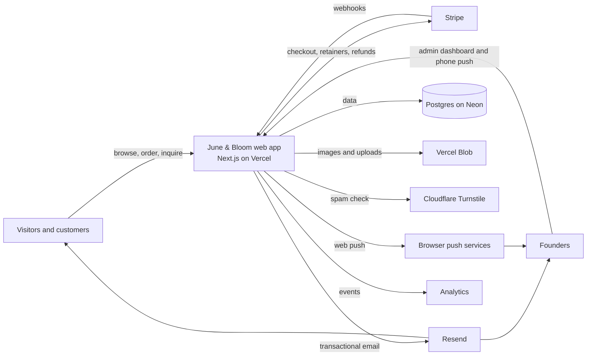
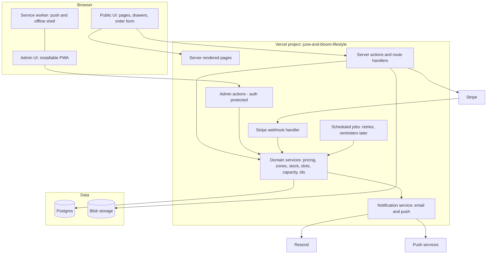
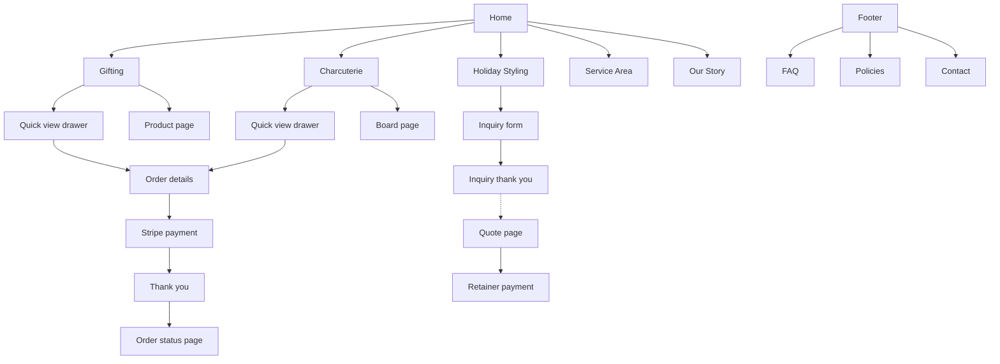
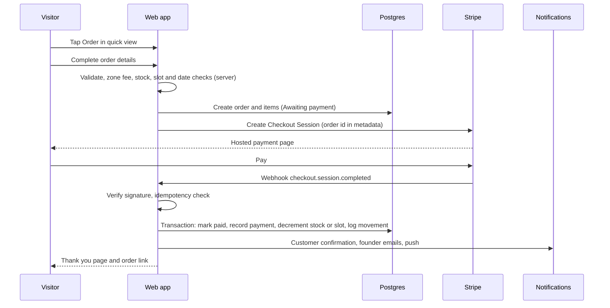
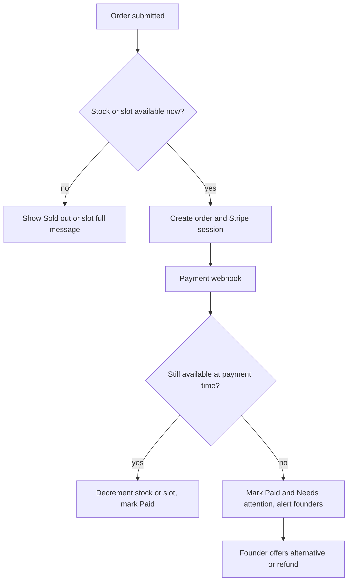
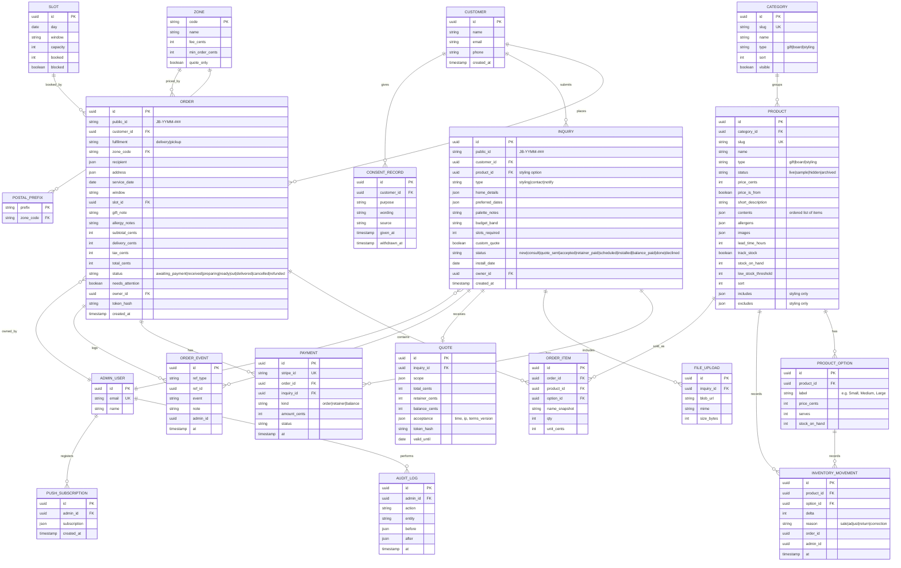
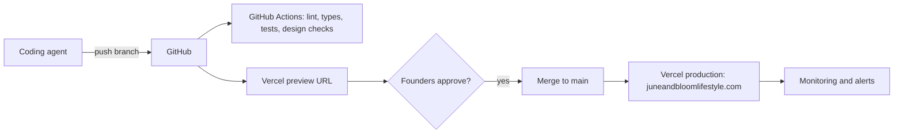

# June & Bloom Website: Architecture Artifacts

**Version:** 2.0 (supersedes 1.0) | **Date:** 2026-10-22 | **Companion docs:** `01-PRD.md`, `02-Implementation-Plan.md`
Diagrams use Mermaid (renders in GitHub, VS Code with a Mermaid extension and most markdown viewers). Wireframes are ASCII.

---

## 1. Architecture principles

1. **Simplest structure that works.** One web app, one database, a few hosted services. No microservices.
2. **Three steps to order.** Choose, Details, Pay. Every design choice protects this.
3. **Products and stock are data.** Managed in the admin, not in code.
4. **Persist first, notify second.** Save the record, then send email or push.
5. **Hosted payments.** Card data never touches our servers.
6. **The server is the authority.** Prices, fees, stock and slot availability are always computed on the server.
7. **Switches, not deploys.** Availability and settings change in the admin.
8. **Free-tier friendly.** Each service has a free or very low-cost tier and an upgrade path.
9. **Boring and testable.** TypeScript, schema validation, tests for every business rule.

## 2. System context



## 3. Container and component view



## 4. Technology stack and cost

| Layer | Choice | Why | Cost at launch |
|---|---|---|---|
| Framework | Next.js App Router, TypeScript | Server rendering for SEO and speed, server actions for forms, already on Vercel | Free |
| Styling | Tailwind CSS with design tokens | Tokens map to the palette; easy to enforce rules | Free |
| Fonts | Self-hosted via the framework loader | No third-party request, no layout shift | Free |
| Hosting | Vercel (check plan terms for commercial use; Pro if required) | Already set up, previews, CDN | Free to about $20 USD a month |
| Database | Neon Postgres through Vercel | Free tier, SQL integrity for stock and payments | Free |
| ORM | Drizzle | Typed, light migrations | Free |
| Validation | Zod | One schema for client and server | Free |
| Payments | Stripe Checkout (hosted) | No card handling; Apple Pay and Google Pay | Transaction fees (about 2.9% plus 30 cents; verify) |
| Email | Resend with the business domain | Simple, good deliverability | Free tier |
| Uploads | Vercel Blob (private for inquiry photos, public for product images) | Same platform | Free tier |
| Spam | Cloudflare Turnstile and honeypot | Free and accessible | Free |
| Admin auth | Auth.js passwordless email link with a two-email allow-list | No passwords | Free |
| Push | Web Push with VAPID keys | Free phone alerts for the installed admin app | Free |
| Realtime | Short-interval polling (every 10 seconds) plus push | Simple and reliable; no extra service | Free |
| Analytics | Vercel Analytics or Plausible | Privacy friendly | Free to low |
| Errors | Vercel logs plus Sentry free tier | Alerts on failures | Free |
| Testing | Vitest, Playwright, axe, Lighthouse CI | Rules, flows, quality | Free |
| CI | GitHub Actions | Checks and preview deployments | Free |

## 5. Information architecture



## 6. Wireframes (structure only)

### 6.1 Home (mobile)
```
+------------------------------+
| June & Bloom     [Order] [=] |  sticky header
|                              |
|   memories that inspire      |
|   Gifts, boards and          |
|   holiday styling by two     |
|   sisters in the GTA         |
|   [ Shop Gifting ]           |
|   Book Holiday Styling >     |
|                              |
|  [Gifting]  [Charcuterie]    |  three tiles
|  [Holiday Styling]           |
|                              |
|  Signature boxes             |
|  [img] Men's Box  from $120  |
|        [ Order ]             |
|  [img] ...                   |
|                              |
|  Two sisters, one standard   |
|  Choose - Personalize - Care |
|  Check your postal code [__] |
|                              |
|  footer on emerald           |
+------------------------------+
```

### 6.2 Quick view drawer (product)
```
+------------------------------+
|  x                           |
|  [ large image 4:5 ]         |
|  Signature Men's Box         |
|  from $120                   |
|  In the box                  |
|   1 item                     |
|   2 item                     |
|   3 item  (5 or 6 items)     |
|  Quantity [- 1 +]            |
|  [ Order ]                   |
+------------------------------+
```

### 6.3 Order details (one page)
```
+------------------------------+
|  Your order: Men's Box x1    |
|  (o) Delivery   ( ) Pickup   |
|  Postal code [___]  Zone: Core, $15
|  Recipient   [__________]    |
|  Address     [__________]    |
|  Date [____]  Window [____]  |
|  Gift note   [__________] 0/200
|  Allergies or avoid [____]   |
|  Your name, email, phone     |
|  [ ] Send me news (optional) |
|  Total  $135                 |
|  [ Continue to payment ]     |
+------------------------------+
```

### 6.4 Charcuterie slot picker
```
Size: ( ) Small  (o) Medium  ( ) Large
Date:  [ calendar: unavailable days faded ]
Time:  [ 11-1 ]  [ 1-3 (full) ]  [ 3-5 ]
Allergies: [ none | peanuts | dairy | ... ]
```

### 6.5 Holiday Styling (three options)
```
+--------+  +--------+  +--------+
| image  |  | image  |  | image  |
| Decor- |  | Decor- |  | Full-  |
| ating  |  | ating  |  | Service|
| Only   |  | + Sourc|  |        |
| from.. |  | from.. |  | custom |
| includes| | includes| | includes|
| [Inquire] [Inquire] [Inquire]  |
+--------+  +--------+  +--------+
```

### 6.6 Admin on a phone
```
Orders | Today | Inventory | Inquiries | More
-------------------------------------------
New (2)  Preparing (3)  Ready (1)  Out (0)
[JB-2610-014  Men's Box  Core  Thu 2-4pm]
[JB-2610-013  Board M    Pickup Fri 1pm  allergy: nuts]
tap card: detail, advance status, print slip
```

## 7. Key flows

### 7.1 Gift or board order



### 7.2 Holiday styling inquiry to retainer

```mermaid
sequenceDiagram
  participant V as Visitor
  participant W as Web app
  participant DB as Postgres
  participant F as Founders
  participant S as Stripe
  V->>W: Submit inquiry (option, home details, photos, dates)
  W->>W: Rules: height, commercial, capacity
  W->>DB: Save inquiry, files, consent
  W->>F: Email and push alert
  W-->>V: Thank you and auto-reply email
  F->>W: Admin: consult, create quote, assign owner
  W-->>V: Secure quote link
  V->>W: Accept terms
  W->>DB: Acceptance record (time, IP, terms version)
  W->>S: Create 40 percent retainer Checkout
  V->>S: Pay retainer
  S->>W: Webhook
  W->>DB: Status Retainer paid
  F->>W: Schedule install; later create balance link
```

### 7.3 Inventory and slots (decision logic)



Atomic rule: the decrement is a single conditional update (`stock = stock - qty WHERE stock >= qty`). If it affects zero rows the order is flagged "Needs attention".

## 8. Repository structure

```
juneandbloom/
  docs/                      PRD, plan, architecture, AUDIT.md, RUNBOOK.md, ACCOUNTS.md
  content/
    site.json                name, tagline, contact, social
    faq.json
    policies/*.mdx
    pages/*.json             Home, Our Story copy blocks
  public/
    brand/jb-monogram.svg    supplied file only
    brand/ampersand.svg      chosen ampersand outline
    textures/grain.svg
    icons/                   PWA icons from the monogram
  src/
    app/
      (site)/
        page.tsx
        gifting/ [slug]/
        charcuterie/ [slug]/
        holiday-styling/ inquire/
        order/ [id]/
        service-area/ our-story/ faq/ contact/ policies/[slug]/ thank-you/
      admin/
        orders/ today/ inventory/ products/ slots/ inquiries/ reports/ settings/
      api/
        stripe/webhook/route.ts
        push/subscribe/route.ts
        uploads/route.ts
        orders/poll/route.ts
        cron/jobs/route.ts
    components/
      ui/                    Button, Card, Drawer, Chip, Field, Toast, Placeholder
      site/                  Header, Footer, Hero, ProductCard, QuickView, ZoneChecker, SlotPicker
      admin/                 OrderCard, TrackerBoard, StockEditor, ProductForm, RunSheet
    lib/
      domain/                ids.ts pricing.ts zones.ts stock.ts slots.ts capacity.ts dates.ts rules.ts
      db/                    schema.ts client.ts migrations/ seed.ts
      payments/              stripe.ts webhook.ts
      notify/                email/ templates/ push.ts log.ts
      auth/                  allowlist.ts session.ts
      validation/            schemas.ts
      settings/              settings.ts cache.ts
    styles/tokens.css
  tests/
    unit/ integration/ e2e/
  .env.example
  CONTENT_TODO.md  CHANGELOG.md
```

## 9. Data model



Supporting tables not drawn: `settings` (key, value, updated_at, updated_by), `message_log` (ref, template, status, attempts), `blocked_dates`, `windows` (delivery window definitions), `sequences` (monthly counters for public ids).

Notes:
- Money is stored as integer cents in CAD.
- Order items store a name and price snapshot so later product edits never change history.
- Secure links store only a hash of the token; the raw token travels by email only.
- Deleting a customer removes personal data and anonymises order totals for reporting.

## 10. Interfaces

### 10.1 Public actions and routes
| Route or action | Purpose | Protection |
|---|---|---|
| `startOrder` | Validate details, create order, create Stripe session | Turnstile for first order from a device, rate limit |
| `checkPostalCode` | Zone, fee, earliest date | Rate limit |
| `availability` (gifts and slots) | Dates and slots for the picker | Cached briefly |
| `submitInquiry` | Holiday styling inquiry | Turnstile, file checks |
| `submitContact` | Contact message | Turnstile, honeypot |
| `notifyMe` | Sample product interest with consent | Turnstile |
| `acceptQuote` | Accept terms, create retainer session | Secure token |
| `POST /api/stripe/webhook` | Payment events | Signature verified, idempotent |
| `POST /api/uploads` | Inquiry photos | Signed upload token, type and size limits |
| `GET /order/[id]?t=token` | Order status | Token |

### 10.2 Admin actions (founder session required, enforced on the server)
Orders: list, search, filter, get, advance status, set owner, add note, flag, refund shortcut, batch print.
Inventory: get, adjust with reason, toggle sold out, set threshold.
Products: create, update, reorder, duplicate, hide, archive, upload images.
Slots and zones: edit capacity, block dates, edit windows, zones, postal prefixes.
Inquiries: list, update, create quote, send quote link, create balance link.
Settings: switches, fees, lead times, banner, notification recipients, pickup details.
Reports and exports. Customer data export and delete. Push subscription management.

### 10.3 Stripe events handled
`checkout.session.completed`, `payment_intent.payment_failed`, `charge.refunded`. Each handler verifies the signature, finds the record by metadata, checks whether it was processed, performs the database transaction, and then queues notifications.

### 10.4 Environment variables (`.env.example`)
| Variable | Purpose |
|---|---|
| `DATABASE_URL` | Postgres |
| `NEXT_PUBLIC_SITE_URL` | Canonical URL |
| `STRIPE_SECRET_KEY`, `STRIPE_WEBHOOK_SECRET`, `NEXT_PUBLIC_STRIPE_PUBLISHABLE_KEY` | Payments |
| `RESEND_API_KEY`, `EMAIL_FROM`, `EMAIL_FOUNDERS` | Email |
| `BLOB_READ_WRITE_TOKEN` | Uploads |
| `TURNSTILE_SITE_KEY`, `TURNSTILE_SECRET_KEY` | Spam protection |
| `AUTH_SECRET`, `ADMIN_EMAILS` | Admin sign-in and allow-list |
| `VAPID_PUBLIC_KEY`, `VAPID_PRIVATE_KEY`, `VAPID_SUBJECT` | Web push |
| `CRON_SECRET` | Protect scheduled routes |
| `SENTRY_DSN` | Error tracking |

## 11. Security and privacy

| Area | Control |
|---|---|
| Transport | HTTPS only, HSTS, secure cookies |
| Input | Zod validation on the server for every action; length limits; file type and size limits |
| Payments | Stripe hosted pages; webhook signature check; idempotency; **all prices, fees, totals, stock and slots computed on the server** |
| Abuse | Turnstile, honeypot, rate limits per IP and per email |
| Admin | Passwordless sign-in; allow-list of two emails; server-side checks on every action and API; session timeout; audit log |
| Secure links | Random 32-byte tokens stored hashed; status pages show minimal data |
| Data | Least data; private inquiry uploads; deletion and export tools; 12-month retention rule |
| Consent | Unchecked boxes; wording, time and source stored; one-click unsubscribe |
| Headers | CSP, X-Frame-Options, Referrer-Policy, Permissions-Policy |
| Secrets | Only in Vercel and local env files; never committed |
| Dependencies | Lockfile; update checks; no unmaintained packages |
| Backups | Daily database backup on a plan that supports it, plus a monthly export of orders, customers and inventory to the founders' Drive |

## 12. Deployment and operations



| Topic | Decision |
|---|---|
| Environments | Local, Preview (Stripe test keys, test database), Production (live keys) |
| Migrations | Run in CI on merge; additive only after launch |
| Rollback | Vercel instant rollback; migrations backward compatible |
| Monitoring | Logs, Sentry, uptime ping every 5 minutes, email alerts to both founders |
| Runbook | `docs/RUNBOOK.md`: change a price, add a product, adjust stock, pause an offer, add a blocked date, refund, export data, rotate keys, restore a backup |

## 13. Design system artifacts

### 13.1 Tokens
| Token | Value | Use |
|---|---|---|
| `--ivory` | `#FDFBF7` | Page background (very subtle cream) |
| `--ink` | `#032A19` | Body text (dark forest green) |
| `--emerald` | `#122620` | Headings, header, primary button, footer, gradient end |
| `--gold` | `#E6C687` | Ampersand and small accents; never small text on ivory |
| `--gold-text` | `#9A7B2F` | Gold accent text on ivory when needed (checked for contrast) |
| `--sage` | `#7A8B7B` | Quiet surfaces and tags |
| `--bg-page` | `linear-gradient(to bottom, #FDFBF7 0%, #FDFBF7 85%, #122620 100%)` | Graduation visible only in the last screen before the footer |
| `--grain` | SVG noise at 3 to 5 percent opacity | Texture overlay |
| Spacing | 4, 8, 12, 16, 24, 32, 48, 72, 112 px | Separation without lines |
| Radius | 4 px (cards and buttons), 999 px (chips) | Quiet and refined |
| Motion | 200 to 300 ms ease-out | Drawer and reveal |

### 13.2 Typography
Default: **Bodoni Moda** headings, **Hanken Grotesk** body. Alternates on `/dev/type`: Libre Caslon Display with Albert Sans; Instrument Serif with Figtree. Avoid Inter, Roboto, Arial, Poppins, Space Grotesk, Playfair Display, Cormorant, Fraunces. Type scale: 14, 16, 18, 22, 28, 36, 48, 64 px with tight, confident headline spacing.

### 13.3 Wordmark and ampersand
Wordmark "June & Bloom" in the heading face. The ampersand is the single distinctive element: three candidates on `/dev/ampersand` (italic display ampersand; swash ampersand; engraved style), set slightly larger with a gentle baseline drop, in gold on emerald surfaces and in `--gold-text` on ivory. The chosen glyph is exported as outlined SVG. It never touches the JB monogram.

### 13.4 Component rules
- One primary button style per view (emerald fill, ivory text). Secondary actions are text links.
- No divider elements anywhere; lists use spacing and subtle background blocks.
- Cards have no outlines; use tonal backgrounds and spacing.
- Focus rings are visible and meet contrast.
- Placeholders follow DR-18.

### 13.5 Component inventory
Layout: Header, MobileMenu, Footer, Section, Container.
Site: Hero, OfferTile, ProductCard, QuickViewDrawer, CategoryChips, ZoneChecker, SlotPicker, OrderSummary, StylingOptionCard, InquiryStepper, SisterBio, FaqAccordion, SeasonBanner, ReviewList (hidden when empty).
Forms: TextField, SelectField, DateField, WindowPicker, NoteField with counter, FileDropzone, ConsentCheckbox, StepProgress.
Feedback: Toast, FormError, EmptyState, StatusBadge, Placeholder.
Admin: OrderCard, TrackerBoard, OrderDetail, StockEditor, ProductForm, SlotGrid, RunSheet, PackingSlip, ReportCards, SettingsForm, InstallPrompt.

## 14. Admin architecture

| Concern | Design |
|---|---|
| Shell | Installable PWA; bottom navigation on phones; sidebar on desktop |
| Live updates | New-order polling every 10 seconds (a lightweight endpoint returns counts and the newest order time); toast and soft sound when new; push when the app is in the background |
| Status updates | One tap advances a status; every change writes an event to `order_event` |
| Inventory | Counts shown with low-stock badges; manual adjust requires a reason; sales decrement automatically; history visible per product |
| Products | Form with drag-and-drop images, contents list editor, option editor, status switch (live, sample, hidden) and a live preview |
| Printing | Print stylesheets for packing slips and gift note cards, single and batch |
| Today view | Query by date, grouped by window and zone, with allergies highlighted |
| Permissions | Both founders have full access in v1; every action is logged |

## 15. Domain rules as code (unit tested)

| Module | Function | Rule |
|---|---|---|
| `ids.ts` | `nextPublicId(date)` | `JB-YYMM-###` per month, transaction safe |
| `zones.ts` | `zoneForPostalCode(code)` | Normalise, match prefix, return zone or outside |
| `pricing.ts` | `priceOrder(items, zone, fulfilment, taxMode)` | Subtotal, delivery fee, minimum check, tax if on |
| `pricing.ts` | `retainer(total)` | 40 percent to the cent; balance is the remainder |
| `stock.ts` | `reserveAndDecrement(items)` | Conditional atomic decrement; returns shortages |
| `slots.ts` | `availableSlots(range)` | Honours capacity, lead time, blocked dates |
| `dates.ts` | `availableServiceDates(product)` | Lead time, cutoffs, blocked dates |
| `capacity.ts` | `canAcceptInstall(week, slots)` | 4 per week, commercial or luxury counts as 2, season cap |
| `rules.ts` | `routeInquiry(answers)` | Over 9 ft or commercial leads to custom quote |

## 16. Settings and switches

| Setting | Default | Effect |
|---|---|---|
| `gifting_open` | on | Gifting ordering |
| `charcuterie_open` | on | Board ordering |
| `styling_open` | on | Styling inquiries and quote payments |
| `takedown_storage_open` | off | Takedown and storage option |
| `tax_mode` | off | HST wording and calculation |
| `pickup_address`, `pickup_hours` | empty | Revealed in confirmations |
| Zone fees and minimums | proposed values | Delivery pricing |
| `board_lead_time_hours` | 48 | Board slot rule |
| `weekly_install_slots`, `season_cap` | 4, 24 | Install capacity |
| `banner_text` | empty | Season or notice banner |
| `notify_emails` | both founders | Alert recipients |

Settings are read on the server with about a 60 second cache.

## 17. Quality attributes

| Attribute | Measure | How |
|---|---|---|
| Speed to order | 3 steps, under 10 seconds for returning visitors | Quick view drawers, one-page details, hosted payment |
| Performance | LCP under 2.5 s | Server rendering, image optimization, minimal JS |
| Accessibility | WCAG 2.1 AA | Semantic HTML, contrast tokens, axe in CI, keyboard tests |
| Security | No card data; admin locked | Hosted payments, allow-list, validation, rate limits |
| Reliability | No lost orders or double counts | Persist first, idempotent webhooks, atomic stock, backups |
| Maintainability | New product in minutes; new service type by configuration | Data-driven catalogue |
| Cost | Under about $20 CAD a month | Free tiers with usage watch |
| Privacy | PIPEDA and CASL aligned | Consent store, minimal data, deletion tool |

## 18. Capacity and cost view

| Item | Expected | Headroom |
|---|---|---|
| Visitors | Thousands per month | Ample on Vercel and Neon free tiers |
| Orders and inquiries | Hundreds per season | Ample |
| Emails | Under a few thousand | Within free tier (verify limits at setup) |
| Images | Hundreds | Within free tier (verify) |

Record verified limits in `docs/ACCOUNTS.md` and watch usage monthly.

## 19. Architecture decision records

| ID | Decision | Status | Rationale | Consequence |
|---|---|---|---|---|
| ADR-001 | Audit the current site first; rebuild only if needed | Proposed | Avoid rebuilding for its own sake | WP0 decides |
| ADR-002 | Next.js App Router with TypeScript on Vercel | Proposed | SEO, speed, already on Vercel | Vendor tie; acceptable |
| ADR-003 | Postgres as the single source of truth | Proposed | Integrity for payments, stock and slots; free tier | Exports for spreadsheets |
| ADR-004 | Stripe hosted Checkout | Proposed | Lowest risk; wallets included | Per-transaction fees |
| ADR-005 | Products, options, stock and slots in the database, managed in admin | Accepted | Founders add boxes without a developer; inventory built in | Page copy still in files |
| ADR-006 | Built-in admin as installable PWA with web push | Accepted | Founders chose a built-in dashboard; phone alerts are free | iOS push needs home-screen install; email is the backup |
| ADR-007 | Native inquiry form instead of Tally | Accepted | One system and one dashboard | We build and maintain the form |
| ADR-008 | Polling every 10 seconds instead of websockets | Proposed | Simple and dependable on serverless | Up to 10 seconds delay inside the dashboard; push covers urgency |
| ADR-009 | Delivery fee by postal prefix zone plus free pickup | Accepted | Founders' decision | Zone table needs founder review |
| ADR-010 | Orders hold items in a list from day one; default single item | Proposed | Avoids a later data migration | Minimal cart UI only |
| ADR-011 | Money in integer cents; CAD only | Proposed | No rounding errors | None |
| ADR-012 | Design rules enforced by automated checks (no dividers, tokens only, no black text) | Proposed | Protect the brand look | Checks must be maintained |
| ADR-013 | Optional consult scheduling later | Proposed | Keeps the first release simple | Founders call or message after inquiries |
| ADR-014 | No customer accounts | Proposed | Less friction and scope | Secure links for status |

## 20. Open architecture questions

1. What stack and repository does the current site use? (WP0)
2. Does the Vercel free plan permit this commercial use, or is Pro needed? Check current terms.
3. Do the founders want orders also mirrored to a Google Sheet or Notion? (Optional export job later.)
4. Final zone list and postal prefixes. (Founder input)
